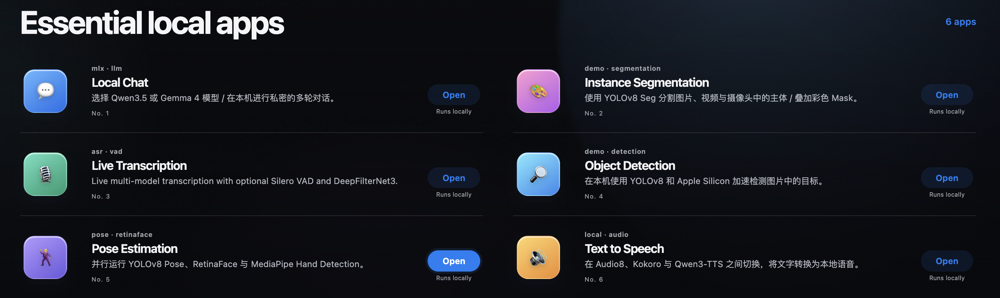
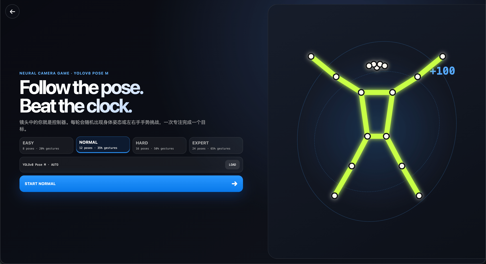
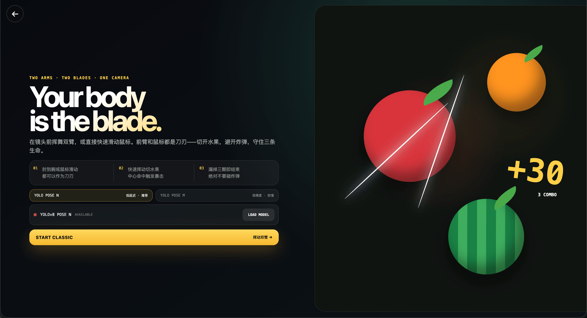
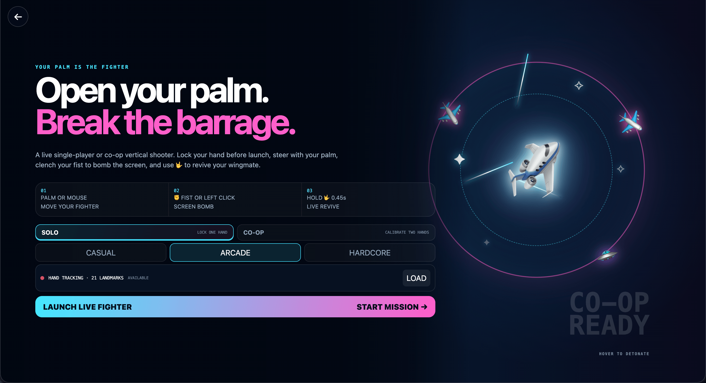
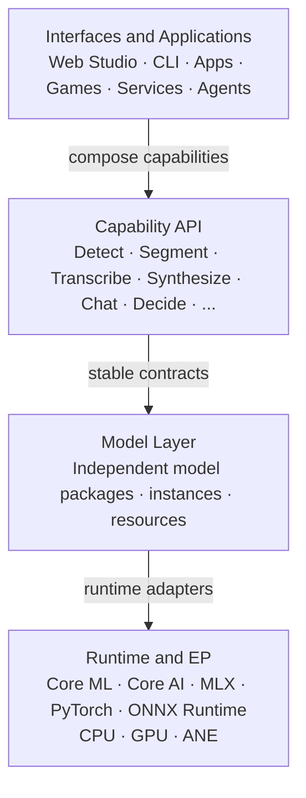

<p align="center">
  
</p>

<h1 align="center">Hugging Mac</h1>

<p align="center">
  <strong>Unleash the power of your Mac. Run AI models and build AI applications locally.</strong>
</p>

Hugging Mac is built to make full use of your Mac’s powerful computing resources—including its CPU, GPU, and Apple Neural Engine. It provides a unified local platform for running computer vision, speech and audio, large language, and multimodal models on Apple Silicon. It also includes tools to convert models for Apple runtimes, validate their outputs, and publish converted artifacts to Hugging Face.

Use the capabilities of these models to create useful, creative, and playful **_applications_**, **_games_**, **_agents_**, **_services_**, and entirely new local AI experiences. Your Mac keeps your data private and does all the work.

## Models

Hugging Mac currently provides 23 model integrations across vision, speech,
language, document processing, and decision making. Each integration exposes a consistent
local lifecycle while retaining the runtime choices that make sense for that
model and Apple Silicon.

| Model                                            | Capability                             | Supported runtimes                 |
| ------------------------------------------------ | -------------------------------------- | ---------------------------------- |
| **Audio8-ASR 0.1B**                              | Speech transcription                   | PyTorch MPS, Core ML               |
| **Audio8 TTS Preview**                           | Speech synthesis                       | PyTorch, MLX, Core AI               |
| **Decision 3.0 (D3)**                            | Multimodal decision making             | PyTorch, Core AI (experimental)     |
| **DeepFilterNet3**                               | Speech enhancement                     | Core ML                            |
| **Gemma 4**                                      | Chat                                   | MLX                                |
| **GLM-OCR**                                      | Document parsing                       | MLX                                |
| **GOT-OCR2.0**                                   | Document parsing                       | MLX                                |
| **Kokoro 82M v1.0**                              | Speech synthesis                       | PyTorch MPS, Core ML               |
| **MediaPipe Hand Detection**                     | Hand detection and tracking            | ONNX Runtime, Core ML              |
| **MOSS-TTS-Nano 100M**                          | Speech synthesis                       | MLX                                |
| **Nemotron 3.5 ASR Streaming Multilingual 0.6B** | Streaming speech transcription         | Core ML                            |
| **PP-DocLayoutV3**                              | Document layout analysis               | PyTorch MPS, Core ML               |
| **Qwen3.5**                                      | Chat and vision-language generation    | MLX                                |
| **Qwen3-ASR**                                    | Speech transcription                   | Core ML                            |
| **Qwen3-TTS**                                    | Speech synthesis                       | MLX, Core ML                       |
| **RetinaFace MobileNet0.25**                     | Face detection                         | PyTorch MPS, Core ML               |
| **SenseVoiceSmall**                              | Speech transcription and understanding | PyTorch MPS, Core ML               |
| **Silero VAD**                                   | Voice activity detection               | Core ML, ONNX Runtime              |
| **Unlimited-OCR**                                | Document parsing                       | MLX                                |
| **Vela3-fast**                                   | Decision making (choice/noul)           | PyTorch, Core AI                    |
| **Ultralytics YOLOv8**                           | Object detection                       | PyTorch MPS, Core ML, ONNX Runtime |
| **Ultralytics YOLOv8 Pose**                      | Pose estimation                        | PyTorch MPS, Core ML, ONNX Runtime |
| **Ultralytics YOLOv8 Seg**                       | Instance segmentation                  | PyTorch MPS, Core ML, ONNX Runtime |

Visit the [Hugging Mac organization on Hugging Face](https://huggingface.co/hugging-mac)
to find converted weights and Apple-oriented model artifacts. Model contributions
are welcome—even if you only help convert an existing model to Core ML or Core AI, add an
MLX variant, benchmark a runtime, reduce memory use, or improve performance on
Apple architectures.

## Model conversion and Hugging Face publishing

The Hugging Face organization card and demo page are maintained in
[`huggingface/`](huggingface/README.md), which includes the source files and
synchronization instructions.

The Model SDK supports local conversion for model integrations that declare a
conversion target. Prepare the original resources, call
`sdk.resources.convert(model_id, target_format)`, then load the converted model
through the same capability API. Available formats and conversion options depend
on the model; see the [SDK model guides](docs/sdk/models/README.md).

For model authors, the separate **Conversion Workbench** provides source snapshot
downloads, Core ML / Core AI graph conversion, comparisons against original model
outputs, SDK capability validation, and Hugging Face publishing. It currently
contains D3 and Vela recipes, including a full Vela3.1-fast Core AI bundle workflow.

Run the workbench in its own environment from the repository root. It has a
separate lockfile because its export toolchain requires newer PyTorch versions
than the application workspace:

```bash
uv sync --project packages/hugging_mac_conversion --locked
uv run --project packages/hugging_mac_conversion --locked hugging-mac-convert list
uv run --project packages/hugging_mac_conversion --locked hugging-mac-convert fetch vela --variant 3-fast
uv run --project packages/hugging_mac_conversion --locked hugging-mac-convert probe vela --variant 3-fast --runtime coreai
```

`probe` tests an internal computation graph; its output is a diagnostic artifact,
not a complete publishable model. Follow the model-specific build and evaluation
steps in the [Vela conversion guide](packages/hugging_mac_conversion/src/hugging_mac_conversion/models/vela/readme.md)
or [D3 conversion guide](packages/hugging_mac_conversion/src/hugging_mac_conversion/models/d3/readme.md).
Original snapshots, converted bundles, and evaluation reports are stored under
Git-ignored `tmp/originals`, `tmp/conversions`, and `tmp/evaluations`.

For a complete bundle that passes the model's validation requirements, inspect
the upload plan before publishing:

```bash
# Authenticate with an account that can write to the configured target repository.
uv run --project packages/hugging_mac_conversion --locked hf auth login

# Replace this with the complete build directory produced by the model recipe.
RUN_DIR="tmp/conversions/<model>/<variant>/<runtime>/<run>"
uv run --project packages/hugging_mac_conversion --locked hugging-mac-convert verify-sdk "$RUN_DIR"
uv run --project packages/hugging_mac_conversion --locked hugging-mac-convert push "$RUN_DIR"
uv run --project packages/hugging_mac_conversion --locked hugging-mac-convert push "$RUN_DIR" --execute
```

`push` defaults to a dry run. `--execute` uploads to the selected variant's
configured Hugging Face repository, under its runtime directory. Authentication
can also use `HF_TOKEN`. Publication checks artifact integrity, model capability
coverage, and SDK validation; actual uploads rerun SDK validation. Incomplete,
failed, or diagnostic-only bundles cannot be published through this workflow.

See the [Conversion Workbench documentation](packages/hugging_mac_conversion/README.md)
for setup, evaluation, and publishing details, and the
[Hugging Mac organization](https://huggingface.co/hugging-mac) for published artifacts.

## Applications



The Studio turns those model integrations into complete local workflows:

- **Object Detection** — detect and compare objects in images, videos, and live
  camera feeds with YOLOv8.
- **Pose Estimation** — run body pose, face, and hand landmark models together
  for real-time human understanding.
- **Instance Segmentation** — separate subjects from images, videos, or a camera
  feed with colored masks and contours.
- **Live Transcription** — compare multiple ASR models with optional voice
  activity detection and speech enhancement in one streaming pipeline.
- **Text to Speech** — synthesize and compare local voices across Audio8 TTS,
  Kokoro, Qwen3-TTS, and MOSS-TTS-Nano.
- **Local Chat** — talk privately with Qwen3.5 or Gemma 4, with optional camera
  understanding, speech input, and spoken responses. Watch the
  [Digital Human demo](https://youtu.be/YPr6fYPnCMQ).

We welcome application contributions of every size: a focused demo, a polished
end-to-end experience, a new model pipeline, or an improvement to an existing
workflow. Combine the available models in ways we have not imagined yet.

## Neural games

Recreate classic games with AI models, allowing players to step into the action
and interact in real time.

Click a poster to watch the demo.

| Demo | Game | Description |
| :---: | --- | --- |
| <a href="https://hugging-mac-readme.static.hf.space/videos/pose-follow.mp4"></a> | **Yolo Pose Follow** | Match body poses and hand gestures before the clock runs out. YOLOv8 Pose tracks your skeleton locally and scores every target in real time. |
| <a href="https://hugging-mac-readme.static.hf.space/videos/fruit-slice.mp4"></a> | **Yolo Fruit Slice** | Turn both forearms into blades, slice fruit, avoid bombs, and build combos. Play with YOLOv8 Pose through the camera, or use the mouse for a quick test. |
| <a href="https://hugging-mac-readme.static.hf.space/videos/palm-thunder.mp4"></a> | **Palm Thunder** | Steer a vertical shooter with your palm, close your fist to trigger a screen bomb, and play solo or co-op with local MediaPipe hand tracking. |

Have an idea for an AI-native game? Contributions are welcome across game
concepts, visual and audio assets, code, interaction design, stories, characters,
levels, and scripts. Let us build playful games for the AI era together.

## Built for learning and building



Hugging Mac keeps **models and applications decoupled**. A model is packaged as
an independent capability provider: it owns its weights, preprocessing,
postprocessing, runtime adapters, and lifecycle, and exposes small, stable
interfaces instead of being built for a specific application.

Models are designed for composition. Applications register independently,
declare the model capabilities they need, and combine those capabilities into
pipelines through the Model SDK without needing to know how each model is
implemented. This enables the same model to be reused across Apps, Games,
services, and agents, while models and applications evolve independently.

## Requirements

- An Apple Silicon Mac
- Python 3.12 or newer
- [uv](https://docs.astral.sh/uv/)
- Node.js 20.19+ or 22.12+ for the web frontend

## Quick start

Install the Python workspace and current model dependencies:

```bash
uv python install 3.12
uv sync --all-packages
```

Start the API:

```bash
uv run hugging-mac-web
```

In another terminal, start the frontend:

```bash
cd apps/web/frontend
npm ci
npm run dev
```

Open <http://127.0.0.1:5173/>. The API documentation is available at
<http://127.0.0.1:8000/docs>.

Open the Studio, prepare a model from the Models page, then choose an App or Game.
For example, run YOLOv8 with MPS or Core ML, transcribe with one of four ASR
families, chat with a local LLM, synthesize speech, or step in front of the camera
and play one of the three neural games.

## Documentation

User and Python SDK documentation starts at [docs/README.md](docs/README.md).
It includes the Studio workflow, model management, the SDK lifecycle, and a
separate usage page for every integrated model.

Serve the documentation locally with Material for MkDocs and Mermaid support:

```bash
uv run --group docs mkdocs serve --dev-addr 127.0.0.1:8001
```

Then open <http://127.0.0.1:8001/>.

For implementation boundaries, see [ARCHITECTURE.md](ARCHITECTURE.md). Technical
module documentation lives beside the SDK and Web code it describes.

## Repository layout

```text
hugging-mac/
├── apps/
│   └── web/
│       ├── backend/              # FastAPI platform and app APIs
│       └── frontend/             # Vue platform and app pages
├── packages/
│   ├── hugging_mac_sdk/          # Standalone model SDK
│   └── hugging_mac_conversion/   # Isolated conversion, evaluation, and Hub publishing
├── configs/                      # Versioned configuration
├── data/                         # Local datasets, ignored by default
├── artifacts/                    # Generated outputs, ignored by default
├── models/                       # Local model cache, ignored by default
├── tests/
├── docs/                         # User and public SDK documentation
├── imgs/                         # README showcase images
├── pyproject.toml
└── uv.lock
```

## Development

Install development and documentation dependencies:

```bash
uv sync --all-packages --group dev --group docs
```

Run the checks:

```bash
uv run ruff check .
uv run mypy packages/hugging_mac_sdk/src apps/web/backend/src
uv run pytest
uv run --group docs mkdocs build --strict
cd apps/web/frontend && npm run build
```

See [CONTRIBUTING.md](CONTRIBUTING.md) before contributing.

## License

hugging-mac is released under the [MIT License](LICENSE).

Model weights, datasets, and third-party dependencies retain their own licenses.
Review their terms before use. Ultralytics YOLO software and models have separate
licensing requirements; Audio8-ASR 0.1B uses `CC-BY-NC-4.0`.
SenseVoiceSmall uses the `FunASR Model Open Source License Agreement 1.1`.
